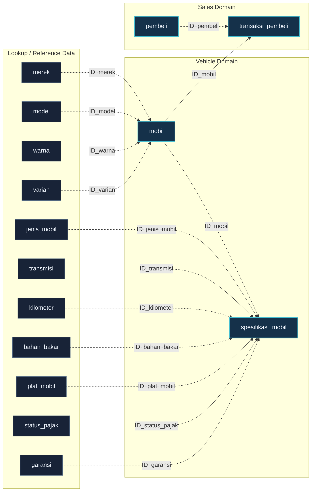

::: {align="center"}
# 🚘 PNJLAN MBL BKS

### Used Car Sales Database · Schema Documentation

**A relational database model for managing vehicle catalogs,
specifications, buyers, and purchase transactions.**

`<br/>`{=html}


`<br/>`{=html}

**Database schema • Relationship map • Interactive schema explorer**
:::

------------------------------------------------------------------------

## 📌 Project Overview

`db_pnjlan_mbl_bks` adalah database relasional untuk sistem katalog dan
transaksi penjualan mobil. Struktur database memisahkan data kendaraan,
spesifikasi, data pembeli, serta transaksi ke dalam tabel-tabel yang
saling terhubung melalui kolom identifier.

Dokumentasi ini dibuat berdasarkan SQL dump yang disediakan. Visualisasi
relasi pada diagram merupakan **hasil identifikasi berdasarkan
kesesuaian kolom dan data contoh**, karena file SQL belum
mendeklarasikan constraint `FOREIGN KEY` secara eksplisit.

### Database at a glance

  Metric                                             Value
  ---------------------------------- ---------------------
  Database                             `db_pnjlan_mbl_bks`
  Database engine                         MariaDB / InnoDB
  Server version in dump                   10.4.22-MariaDB
  Tables                                                17
  Primary keys                                          17
  Explicit foreign-key constraints                       0
  Inferred relationships                                14
  Character set                                  `utf8mb4`

------------------------------------------------------------------------

## 🗺️ Database Schema Visualization

The schema map below groups the database into its core operational
tables and supporting lookup tables.

::: {align="center"}


`<sub>`{=html}High-resolution schema map · 3900 × 2640 px`</sub>`{=html}
:::

### Download visual assets

-   **[High-resolution PNG](assets/database-schema.png)** --- suitable
    for reports, presentations, and portfolio screenshots.
-   **[Scalable SVG](assets/database-schema.svg)** --- vector format
    that stays sharp when zoomed.
-   **[Interactive Schema
    Explorer](assets/database-schema-explorer.html)** --- open the HTML
    file in a modern browser to inspect tables and navigate the diagram.

> **Relationship note:** `FK*` and connector lines indicate inferred
> relationships, not database-enforced foreign keys. Verify the joins
> and add actual constraints before relying on referential integrity in
> production.

------------------------------------------------------------------------

## 🧱 Database Architecture

The schema can be understood as three logical areas:

1.  **Vehicle catalog** --- vehicle identity and catalog attributes such
    as brand, model, color, and variant.
2.  **Vehicle specifications** --- vehicle category, transmission,
    mileage, fuel, plate region, tax status, warranty, condition, and
    price.
3.  **Sales transaction** --- buyer records and purchase transactions.



`<sub>`{=html}Dashed connectors = inferred joins from matching
identifier columns. This is a documentation view, not a declaration of
SQL constraints.`</sub>`{=html}

------------------------------------------------------------------------

## 🗃️ Table Inventory

### Core tables

  ------------------------------------------------------------------------
  Table                   Purpose                 Key column
  ----------------------- ----------------------- ------------------------
  `mobil`                 Master data kendaraan   `ID_mobil`

  `spesifikasi_mobil`     Detail spesifikasi dan  `ID_mobil`
                          harga kendaraan         

  `pembeli`               Informasi pembeli       `ID_pembeli`

  `transaksi_pembeli`     Catatan transaksi       `ID_transaksi_pembeli`
                          pembelian               
  ------------------------------------------------------------------------

### Lookup and reference tables

  Table              Purpose                     Key column
  ------------------ --------------------------- ---------------------
  `merek`            Referensi merek mobil       `ID_merek`
  `model`            Referensi model mobil       `ID_model`
  `warna`            Referensi warna mobil       `ID_warna`
  `varian`           Referensi varian mobil      `ID_varian`
  `jenis_mobil`      Kategori/jenis bodi mobil   `ID_jenis_mobil`
  `transmisi`        Jenis transmisi             `ID_transmisi`
  `kilometer`        Referensi kilometer         `ID_kilometer`
  `bahan_bakar`      Jenis bahan bakar           `ID_bahan_bakar`
  `plat_mobil`       Kode plat dan wilayah       `ID_plat_mobil`
  `status_pajak`     Status pajak kendaraan      `ID_status_pajak`
  `garansi`          Referensi durasi garansi    `ID_garansi`
  `jenis_kelamin`    Referensi jenis kelamin     `ID_jns_kelamin`
  `tahun_produksi`   Referensi tahun produksi    `ID_tahun_produksi`

`jenis_kelamin` dan `tahun_produksi` tersedia sebagai tabel referensi di
dump, tetapi tidak memiliki relasi langsung yang dapat dipastikan dari
struktur kolom saat ini.

------------------------------------------------------------------------

## 🔗 Relationship Map

The following 14 links were inferred from matching identifier columns in
the supplied SQL schema:

  Source table     Target table          Matching column
  ---------------- --------------------- -------------------
  `merek`          `mobil`               `ID_merek`
  `model`          `mobil`               `ID_model`
  `warna`          `mobil`               `ID_warna`
  `varian`         `mobil`               `ID_varian`
  `mobil`          `spesifikasi_mobil`   `ID_mobil`
  `jenis_mobil`    `spesifikasi_mobil`   `ID_jenis_mobil`
  `transmisi`      `spesifikasi_mobil`   `ID_transmisi`
  `kilometer`      `spesifikasi_mobil`   `ID_kilometer`
  `bahan_bakar`    `spesifikasi_mobil`   `ID_bahan_bakar`
  `plat_mobil`     `spesifikasi_mobil`   `ID_plat_mobil`
  `status_pajak`   `spesifikasi_mobil`   `ID_status_pajak`
  `garansi`        `spesifikasi_mobil`   `ID_garansi`
  `pembeli`        `transaksi_pembeli`   `ID_pembeli`
  `mobil`          `transaksi_pembeli`   `ID_mobil`

------------------------------------------------------------------------

## 🧰 Technology Stack & Tools

The table below separates technologies evidenced by the supplied SQL
dump and generated documentation artifacts from tools that are not
identified in the source.

  -----------------------------------------------------------------------
  Layer                   Technology / Tool       Usage / evidence
  ----------------------- ----------------------- -----------------------
  Database                **MariaDB 10.4.22**     Database server version
                                                  recorded in the SQL
                                                  dump

  Storage engine          **InnoDB**              Table engine specified
                                                  in `CREATE TABLE`
                                                  statements

  Query language          **SQL**                 Schema definition,
                                                  inserts, indexes, and
                                                  table alterations

  Database administration **phpMyAdmin 5.1.1**    SQL dump header
                                                  identifies phpMyAdmin
                                                  as dump generator

  Dump environment        **PHP 8.0.13**          PHP version recorded in
  metadata                                        the dump header; this
                                                  does not prove PHP is
                                                  the application backend

  Schema visualization    **SVG**                 Scalable database
                                                  diagram

  Image export            **PNG**                 High-resolution diagram
                                                  export

  Interactive             **HTML5, CSS3,          Browser-based schema
  documentation           JavaScript**            explorer
  -----------------------------------------------------------------------

### Interactive explorer capabilities

-   Pan and zoom the schema canvas.
-   Search for table and column names.
-   Select a table to inspect its columns and data types.
-   Highlight related tables and inferred relationships.
-   Export the diagram as SVG or PNG.

No frontend framework or JavaScript package is declared by the generated
explorer. It is a self-contained HTML file using browser-native
technologies.

------------------------------------------------------------------------

## ⚙️ Getting Started

### 1. Requirements

-   MariaDB compatible with the SQL dump (the source records MariaDB
    10.4.22).
-   phpMyAdmin or another SQL client capable of importing `.sql` files.
-   A modern web browser for the interactive schema explorer.

### 2. Import the database

1.  Start your MariaDB server.
2.  Open phpMyAdmin.
3.  Create a database named `db_pnjlan_mbl_bks` if it does not already
    exist.
4.  Select the database and open the **Import** tab.
5.  Choose `db_pnjlan_mbl_bks.sql`.
6.  Run the import and inspect the result.

If the database is already created, confirm the selected database name
before importing.

### 3. Open the schema explorer

Open `assets/database-schema-explorer.html` directly in a browser. The
explorer is a static client-side document and does not require a backend
service.

------------------------------------------------------------------------

## ⚠️ Data Model Notes & Improvement Opportunities

These are observations from the supplied SQL dump, not assumptions about
application behavior.

1.  **No explicit foreign keys.** The dump adds primary keys but does
    not add `FOREIGN KEY` constraints. The inferred links should be
    validated before constraints are introduced.
2.  **Year reference mismatch.** `spesifikasi_mobil.ID_tahun` does not
    match the identifier name/type of
    `tahun_produksi.ID_tahun_produksi`. The current dump does not
    establish a reliable direct relationship.
3.  **Specification identifier.**
    `spesifikasi_mobil.ID_speksifikasi_mobil` is nullable and is not the
    primary key. The table's primary key is `ID_mobil`.
4.  **Gender lookup is disconnected.** `pembeli.Jns_kelamin` contains
    values such as `L` and `P`, while `jenis_kelamin` defines
    `ID_jns_kelamin`. No explicit relationship is declared.
5.  **Data type review.** `Harga` is stored as `int(11)` and `No_Hp` as
    `bigint(20)`. For a production redesign, consider suitable numeric
    and string representations based on application requirements. Phone
    numbers are usually identifiers, not quantities.
6.  **Zero dates and year values.** The sample data includes
    `0000-00-00` dates and `0000` year values. Review SQL mode and data
    validity before migrating or using strict date validation.

### Suggested next steps

-   Validate every inferred relationship against actual business rules
    and existing records.
-   Add foreign-key constraints only after checking for orphan records
    and incompatible values.
-   Decide whether `tahun_produksi` and `jenis_kelamin` should be
    connected to their corresponding columns.
-   Normalize phone number and monetary data types according to
    application requirements.
-   Add a concise data dictionary and sample query documentation as the
    project evolves.

------------------------------------------------------------------------

## 📁 Repository Structure

``` text
pnjlan-mbl-bks/
├── README.md
└── assets/
    ├── db_pnjlan_mbl_bks.sql
    ├── database-schema.png
    ├── database-schema.svg
    └── database-schema-explorer.html
```

------------------------------------------------------------------------

## 📄 Source & Scope

This documentation is based on the supplied `db_pnjlan_mbl_bks.sql` dump
and the schema visualization artifacts generated from it.

-   SQL dump metadata: phpMyAdmin 5.1.1, MariaDB 10.4.22, PHP 8.0.13.
-   Database tables use InnoDB and `utf8mb4`.
-   Relationship connectors are inferred; the source does not declare
    explicit foreign-key constraints.
-   The supplied source does not identify an application backend,
    frontend framework, deployment platform, IDE, or version-control
    workflow. Those technologies are therefore not listed as confirmed
    project stack.

------------------------------------------------------------------------

::: {align="center"}
**PNJLAN MBL BKS · Database Documentation**

`<sub>`{=html}Built for clear data modeling, technical documentation,
and future development.`</sub>`{=html}
:::
